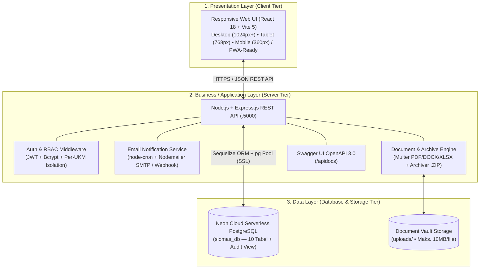

# SIOMAS — Sistem Informasi Operasional & Manajemen Administrasi UKM


**SIOMAS** adalah aplikasi web *Full-Stack* berarsitektur **3-Tier** untuk mendigitalisasi tata kelola operasional, administrasi **LPJ & SPJ Sipakamase**, penjadwalan kegiatan, delegasi tugas kepanitiaan, pengumuman berprioritas dengan pengingat email terjadwal (*Scheduled Email Reminders*), hingga jejaring kolaborasi **Hub Inter-UKM** di lingkungan Universitas Hasanuddin.

Seluruh spesifikasi mengacu pada dokumen **`SRS_SIOMAS_FASE2_REVISI (2) (3).pdf`** dan **[`PRD_SIOMAS_Full_Spec.md`](./PRD_SIOMAS_Full_Spec.md)**.

---

## Arsitektur 3-Tier (Sesuai Gambar 6.1 SRS Fase 2)



1. **Presentation Layer (`Frontend/`)**:
   - Dibangun menggunakan **React 18 + Vite 5** dengan desain **Responsive Web UI** (*Desktop*, *Tablet*, *Smartphone* hingga `360px`) serta **PWA-Ready** (`manifest.json`).
   - Dilengkapi *Collapsible Sidebar Drawer* pada layar tablet/mobile, kartu metrik adaptif, serta pembungkus tabel anti-*off-side* (`overflow-x: auto`).
2. **Business / Application Layer (`Backend-Express/`)**:
   - **Node.js + Express.js REST API** (`Backend-Express/server.js`) sebagai *engine* utama sesuai Gambar 6.1 SRS.
   - Autentikasi **JWT (JSON Web Token)** via Header `Authorization: Bearer <token>`, Cookie `siomas_token`, maupun query `?token=`, ditambah hashing password **Bcrypt**.
   - **Isolasi Data Per-UKM**: Akun **Ketua UKM**, **Pengurus Divisi**, dan **Anggota UKM** otomatis difilter berdasarkan organisasi UKM masing-masing (kecuali pada **Hub Inter-UKM** yang bersifat lintas UKM).
   - **Email Reminder Scheduler (`UC-12`)**: Job terjadwal (`node-cron`) untuk pengiriman pengumuman & pengingat otomatis **Attempt 1 (Saat Publikasi)**, **Attempt 2 (+24 Jam)**, dan **Attempt 3 (+48 Jam)** bagi anggota yang belum membaca pengumuman (*auto-stop* ketika sudah dibaca), dilengkapi endpoint webhook `/api/v1/webhooks/email-status`.
   - *(Opsional)* Tersedia juga modul fallback Python Flask di direktori `Backend/` yang terhubung ke database Neon yang sama.
3. **Data Layer (Neon Cloud Serverless PostgreSQL)**:
   - Menggunakan **Neon Cloud PostgreSQL (`siomas_db`)** sehingga **seluruh anggota tim pengembang berbagi database cloud yang sama secara *real-time*** tanpa perlu instalasi MySQL/PostgreSQL lokal.

---

## Cakupan 12 Use Case (SRS Fase 2)

| Kode | Nama Use Case | Aktor Utama | Endpoint Utama |
| :--- | :--- | :--- | :--- |
| **UC-01** | Registrasi & Autentikasi Pengguna (JWT + Bcrypt) | Semua Aktor | `POST /api/v1/auth/register`, `POST /api/v1/auth/login` |
| **UC-02** | Manajemen Profil & Isolasi Organisasi UKM | Semua Aktor | `GET /api/v1/profile`, `PUT /api/v1/profile` |
| **UC-03** | Konfigurasi Hak Akses Peran (RBAC Matrix & Users) | Ketua UKM | `GET/PUT /api/v1/rbac/matrix`, `GET/PUT/DELETE /api/v1/users` |
| **UC-04** | Lihat Kalender & Detail Kegiatan UKM | Semua Aktor | `GET /api/v1/schedules` |
| **UC-05** | Kelola Jadwal Kegiatan & Deteksi Konflik Jadwal | Pengurus Divisi, Ketua UKM | `POST /api/v1/schedules`, `PUT/DELETE /api/v1/schedules/:id` |
| **UC-06** | Unggah & Revisi Dokumen LPJ / SPJ Sipakamase | Pengurus Divisi | `POST /api/v1/documents`, `POST /api/v1/documents/:id/revise` |
| **UC-07** | Delegasi Tugas, Presensi Kehadiran & Dasbor Koordinator | Semua Aktor | `PUT /api/v1/schedules/:id/rsvp`, `GET /api/v1/coordinator/stats` |
| **UC-08** | Publikasi Pengumuman Berprioritas & Target Audiens | Pengurus Divisi, Ketua UKM | `GET/POST /api/v1/announcements`, `POST /api/v1/announcements/:id/read` |
| **UC-09** | Validasi LPJ & Verifikasi Berkas SPJ Sipakamase | Ketua UKM | `PUT /api/v1/documents/:id/validate`, `PUT /api/v1/documents/:id/verify-spj` |
| **UC-10** | Repository Vault & Unduh Bundel `.ZIP` LPJ + SPJ | Semua Aktor | `GET /api/v1/documents/:id/download`, `GET /api/v1/documents/bundle-zip` |
| **UC-11** | Hub Inter-UKM (Papan Informasi & Kolaborasi Lintas UKM) | Ketua UKM, Pengurus Divisi | `GET/POST /api/v1/interukm`, `PUT/DELETE /api/v1/interukm/:id` |
| **UC-12** | Log Pengiriman Email Terjadwal (Attempt 1–3) & Audit Trail | Ketua UKM | `GET /api/v1/email-logs`, `POST /api/v1/email-logs/trigger-reminders`, `GET /api/v1/audit-logs` |

---

## Struktur Direktori Proyek

```text
siomas-flask/
├── Backend-Express/               # [UTAMA] Server Tier — Node.js + Express.js REST API (Modular)
│   ├── config/
│   │   ├── database.js            # Koneksi Neon Cloud PostgreSQL (pg Pool + Sequelize ORM)
│   │   └── upload.js              # Konfigurasi Multer penyimpanan berkas (Maks. 10MB)
│   ├── middlewares/
│   │   └── authMiddleware.js      # JWT Authentication (Header/Cookie/Query) & RBAC Role Guard
│   ├── services/
│   │   └── emailService.js        # Nodemailer SMTP + node-cron UC-12 Reminder (Attempt 1, 2, 3)
│   ├── utils/
│   │   └── helpers.js             # Bcrypt hashing, parser organisasi UKM & Audit Trail Logger
│   ├── routes/
│   │   ├── swaggerRoutes.js       # Health check (/api/v1/health) & Swagger UI (/apidocs)
│   │   ├── authRoutes.js          # UC-01 & UC-03: Register, Login, Verifikasi & RBAC Anggota
│   │   ├── profileRoutes.js       # UC-02: Profil Pengguna & Jobdesk UKM
│   │   ├── scheduleRoutes.js      # UC-04 & UC-05: Kalender Agenda Kegiatan UKM
│   │   ├── announcementRoutes.js  # UC-08: Pengumuman Berprioritas & Status Baca
│   │   ├── documentRoutes.js      # UC-06, UC-09, UC-10: LPJ, Sipakamase, Vault & Bundel .ZIP
│   │   ├── interukmRoutes.js      # UC-11: Hub Inter-UKM & Kolaborasi Lintas UKM (BR-02)
│   │   └── notificationRoutes.js  # UC-07 & UC-12: Statistik, Log Email, Scheduler, Webhook & Audit
│   ├── server.js                  # Entry point utama yang merangkai middleware & seluruh routes
│   ├── package.json               # Dependensi Node.js (express, sequelize, pg, jsonwebtoken, dll.)
│   └── .env                       # Konfigurasi koneksi Neon Cloud PostgreSQL & JWT Secret
├── Frontend/                      # [UTAMA] Client Tier — React 18 + Vite 5 Responsive Web UI
│   ├── index.html                 # Root HTML + Viewport + PWA Manifest Link
│   ├── public/manifest.json       # Konfigurasi Progressive Web App (PWA)
│   ├── css/                       # Stylesheet utama + Media Queries Responsive (Desktop/Tablet/HP)
│   └── src/
│       ├── api.js                 # Helper HTTP Client & manajemen token/cookie otomatis
│       ├── pages/                 # Halaman Login, Register, dan Portal Role-Based
│       └── components/
│           ├── anggota/           # Modul UI Anggota UKM (5 Tab)
│           ├── pengurus/          # Modul UI Pengurus Divisi (7 Tab)
│           └── ketua/             # Modul UI Ketua UKM (9 Tab)
├── Backend/                       # [OPSIONAL] Modul alternatif Python Flask + Skrip Migrasi Neon
│   ├── app.py                     # Server Flask alternatif (port 5000)
│   └── migrate_to_neon.py         # Skrip migrasi & sinkronisasi skema + seed ke Neon PostgreSQL
├── PRD_SIOMAS_Full_Spec.md        # Dokumentasi Spesifikasi Teknis & 12 Use Case Lengkap
├── SRS_SIOMAS_FASE2_REVISI (2) (3).pdf # Dokumen SRS Fase 2 Revisi
└── README.md                      # Dokumentasi Utama Proyek
```

---

## Panduan Instalasi & Menjalankan Proyek (Untuk Tim)

Karena proyek ini telah terhubung ke **Neon Cloud Serverless PostgreSQL (`siomas_db`)**, rekan satu tim **tidak perlu** menginstal atau membuat database lokal terlebih dahulu.

### Prasyarat
- **Node.js** v18+ (disarankan v20 / v24 LTS) & `npm`

### 1. Menjalankan Backend (`Node.js + Express.js REST API`)

Buka terminal pertama, masuk ke direktori `Backend-Express`, lalu instal dependensi dan jalankan server:

```powershell
cd Backend-Express
npm install
npm start
```

Server REST API akan aktif di **`http://127.0.0.1:5000`**.

> **Catatan:** Pastikan tidak ada proses lain yang sedang memakai port `5000` (misalnya server Flask lama). Jika muncul `EADDRINUSE: address already in use 0.0.0.0:5000`, hentikan proses di port 5000 terlebih dahulu.

### 2. Menjalankan Frontend (`React 18 + Vite`)

Buka terminal kedua, masuk ke direktori `Frontend`, lalu instal dependensi dan jalankan *dev server*:

```powershell
cd Frontend
npm install
npm run dev
```

Aplikasi web dapat diakses melalui browser di **`http://localhost:5173`**.

---

## Cara Mengakses & Menguji REST API

Terdapat **3 cara mudah** untuk mengakses dan menguji endpoint REST API SIOMAS:

1. **Swagger UI Interaktif (Rekomendasi)**:
   - Buka **`http://127.0.0.1:5000/apidocs`** di browser.
   - Dokumentasi lengkap seluruh endpoint tersedia beserta tombol **Try it out** dan **Authorize** (Bearer JWT).
2. **Langsung di Browser (Cookie Session Otomatis)**:
   - Login terlebih dahulu melalui web **`http://localhost:5173`** atau melalui Swagger `/api/v1/auth/login`.
   - Server otomatis menyimpan cookie `siomas_token`, sehingga Anda dapat membuka URL seperti **`http://127.0.0.1:5000/api/v1/profile`** atau **`http://127.0.0.1:5000/api/v1/schedules`** langsung di tab browser.
3. **Health Check Publik (Tanpa Login)**:
   - Buka **`http://127.0.0.1:5000/api/v1/health`** untuk memeriksa status koneksi server Express.js dan database Neon Cloud PostgreSQL.

---

## Daftar Akun Default (Testing & Demo)

Seluruh akun bawaan di bawah ini menggunakan password: **`password123`**

### 1. Akun Ketua UKM (Isolasi Data Per-UKM)
Setiap Ketua UKM hanya melihat dokumen LPJ/SPJ, jadwal internal, manajemen akses anggota, dan log di dalam organisasi UKM yang dipimpinnya:

| Email | Password | Organisasi UKM |
| :--- | :--- | :--- |
| `ketua.robotika@siomas.com` | `password123` | UKM Robotika |
| `ketua.seni@siomas.com` | `password123` | UKM Seni & Budaya |
| `ketua.olahraga@siomas.com` | `password123` | UKM Olahraga |
| `ketua.penalaran@siomas.com` | `password123` | UKM Penalaran & Riset |
| `ketua.ksr@siomas.com` | `password123` | UKM KSR PMI |
| `ketua.pers@siomas.com` | `password123` | UKM Pers Mahasiswa |
| `ketua.mapala@siomas.com` | `password123` | UKM Mapala |
| `ketua@siomas.com` | `password123` | UKM Robotika (Default Demo) |

### 2. Akun Pengurus Divisi
| Email | Password | Organisasi UKM | Divisi |
| :--- | :--- | :--- | :--- |
| `pengurus@siomas.com` | `password123` | UKM Robotika | Divisi Acara & Kompetisi |
| `robotikapengurus@siomas.com` | `password123` | UKM Robotika | Divisi Acara & Kompetisi |

### 3. Akun Anggota UKM
| Email | Password | Organisasi UKM | Divisi |
| :--- | :--- | :--- | :--- |
| `anggota@siomas.com` | `password123` | UKM Robotika | Divisi Riset & Teknologi |
| `anggotarobotika@siomas.com` | `password123` | UKM Robotika | Divisi Riset & Teknologi |

---

## Skema Database Cloud (Neon PostgreSQL — 10 Tabel + 1 View)

1. **`users`** — Data pengguna, peran (`Anggota UKM`, `Pengurus Divisi`, `Ketua UKM`), organisasi `ukm`, `divisi`, dan status aktif.
2. **`permissions`** — Daftar 9 kode izin operasional (`VIEW_SCHEDULE`, `MANAGE_SCHEDULE`, `UPLOAD_LPJ_SPJ`, `VALIDATE_LPJ_SPJ`, `PUBLISH_ANNOUNCEMENT`, `MANAGE_USERS_RBAC`, `ACCESS_INTERUKM_HUB`, `VIEW_AUDIT_EMAIL_LOGS`, `MANAGE_TASK_DELEGATION`).
3. **`role_permissions`** — Pemetaan matriks RBAC antara peran dan kode izin (`UC-03`).
4. **`schedules`** — Jadwal kegiatan, rapat, penugasan kepanitiaan (`assigned_to`), serta status presensi/kehadiran (`attendance_status`) (`UC-04`, `UC-05`, `UC-07`).
5. **`documents`** — Berkas LPJ & SPJ Sipakamase, versi revisi (`revision_number`), status validasi, dan rincian anggaran (`rab_anggaran`, `realisasi_anggaran`) (`UC-06`, `UC-09`, `UC-10`).
6. **`announcements`** — Pengumuman berprioritas (`Normal`, `Penting`, `Mendesak / Urgent`) dan target audiens (`UC-08`).
7. **`announcement_reads`** — Pencatatan waktu baca pengumuman per anggota untuk menghentikan pengingat email otomatis (`UC-08`, `UC-12`).
8. **`email_logs`** — Log pengiriman email pengumuman dan pengingat terjadwal (`Attempt 1`, `Attempt 2`, `Attempt 3`) beserta status *delivery* (`UC-12`).
9. **`interukm_posts`** — Publikasi program kolaborasi, peminjaman inventaris, dan undangan lintas UKM (`UC-11`).
10. **`audit_logs`** & View **`system_audit_logs`** — Rekam jejak perubahan data kritis dengan *JSON Before/After State* (`old_value` & `new_value`) serta alamat IP (`UC-12`).
